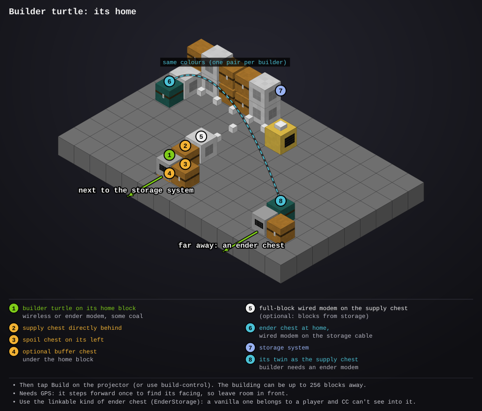

# builder-turtle

- **Type:** turtle with a pickaxe (a mining turtle), plus a wireless or ender modem
- **Computer ID:** 
- **Label:** 
- **Location:** 

## What it does

Builds whatever a [blueprint projector](../blueprint-projector/README.md) is
showing, exactly where it's shown, or a plan sent from
[build control](../build-control/README.md) at coordinates you type. Move and turn the projection until the
building sits where you want it, tap **Build** on the projector's panel, and
the projector sends the plan (every block, in real world coordinates) to
this turtle over rednet.

The turtle then:

1. **Clears the plot:** everything inside the building's box is dug out
   (grass, trees, a hill in the way). Chests, computers and turtles are never
   dug. A plan built in the air, like the projector's
   [sky station](../blueprint-projector/README.md#building-in-the-sky),
   skips this.
2. **Builds it from the bottom up,** one layer at a time, back and forth
   along the rows, placing each block from the block above it. Doors go in
   last on their layer, from the side.
3. **Comes home** when it runs low on blocks or fuel or its inventory is
   full: what it dug up goes in the spoil chest, unused blocks go back in the
   supply chest, and it loads up the next stretch of blocks (13 stacks at a
   time) before heading back.
4. **Reports to the projector** as it goes. The projector's panel shows
   what it's doing ("Builder #7: building, 340 of 1200 (28%)"), and in Layer
   view the projection follows the layer it's on. Tap **Stop** on the panel to
   call it off.

If it runs out of a block, it asks a [storage system](../storage-computer/README.md)
for more (if there's one in range), and otherwise waits for you to put some
in the supply chest. It says what it's waiting for in orange on its screen
("Waiting for stone bricks (64)"), and the projector's monitor, build
control and the [status server](../status-server/README.md) show the same
line, added up over every builder.

### Several builders

Set up more builder turtles, each on its own home block with its own supply
and spoil chests, and the projector shares a building between every one in
range (up to 4), busy ones too. It cuts the building into side-by-side strips across its
longer side, at least 3 blocks wide, and each turtle clears and builds only
its strip, from the bottom up as usual. Each one flies over the building at
a height of its own, so they don't meet in the air, and never stands in
another turtle's strip (doors on a strip's edge go in from its own side, or
from outside the building).

The free ones start straight away. A strip no turtle could take yet (busy,
or too far from home) waits: it goes to the first turtle that finishes its
own strip, or to one that's free when the projector looks again (every 30
seconds). Each turtle's screen says
which strip it's on, e.g. "Building Cottage (strip 2 of 3): 410 blocks."

## Files

- `builder.lua`: the program
- `startup.lua`: starts it on boot: it carries on with an unfinished building, or waits for one (first it fetches any newer version from the website)
- [`lib/nav.lua`](../../lib/nav.lua): position tracking and movement (copy to `/lib/nav.lua`)
- [`lib/report.lua`](../../lib/report.lua): reports to the status server (copy to `/lib/report.lua`)
- [`lib/errlog.lua`](../../lib/errlog.lua): saves any error to `/errors.log` so you can read it later with `edit /errors.log` (copy to `/lib/errlog.lua`).
- [`lib/claim.lua`](../../lib/claim.lua): tells the storage computer which chest is the supply chest (copy to `/lib/claim.lua`)
- [`lib/crafts.lua`](../../lib/crafts.lua): has the craft overseer make what storage hasn't got (copy to `/lib/crafts.lua`)
- [`lib/net.lua`](../../lib/net.lua): rednet requests and answers (copy to `/lib/net.lua`). Needed.
- [`lib/files.lua`](../../lib/files.lua): crash-safe save files (copy to `/lib/files.lua`). Needed by lib/nav.lua.
- [`lib/inv.lua`](../../lib/inv.lua): inventory and fuel helpers (copy to `/lib/inv.lua`). Needed.
- `preview/`: the setup diagram (a picture, not installed)

## Setup



1. Put the turtle on its **home** block, near where you'll build (up to 256
   blocks away). Give it a wireless or ender modem and some coal.
2. Put the **supply chest** directly behind it and a **spoil chest** directly
   to its left. Fill the supply chest with the blocks the building needs and
   some coal: `projector check <plan>` on the projector lists them.
   Optional, but best with a big mixed supply chest or barrel: a plain
   **buffer chest** directly **under** the home block (the turtle sits on
   it). See [Things to know](#things-to-know).
3. Install the program and run `builder`. It needs
   [GPS](../gps-deployer/README.md): it finds its position and facing by itself
   (give it a little fuel and room in front, since it steps forward once). That
   block is now its home.
4. Reboot it. It waits for a building.
5. On the projector, put the building where you want it and tap **Build**
   (or press B, or run `projector build`).

```
builder              -- wait for a building (startup.lua does this)
builder setup        -- make this block home (found with GPS)
builder status       -- what it's building and how far along
builder cancel       -- forget the building it's working on
```

### Getting blocks from the storage system

With a [storage computer](../storage-computer/README.md) in range and a
**wired modem on the supply chest**, joined to the storage cable, the
builder orders each load of blocks (and coal) from it before taking them
from the chest. With crafting set up there, things like stairs and slabs get
crafted as needed.

There's nothing to set up on the storage computer: the first time the
builder orders something, it tells the storage computer which chest is its
supply chest and says "The storage system sends my blocks to my supply chest
(...)". Several builders can share one storage system, each with its own
supply chest. If it can't find the chest (no modem on it, or the modem isn't
red) it says so and tries again 5 minutes later.

### Far from the storage system: an ender chest

Building somewhere the storage cable doesn't reach (another base, the
Nether, a build site across the map)? Use a pair of linked ender chests:
one on the storage cable at your base, its twin as the builder's supply
chest. Whatever the storage system sends into the one at home comes out
behind the builder. There's nothing to set up in either program: it's only
where the blocks go.

At your base, on the storage cable:

```
[storage chests]==cable==[wired modem, red][ender chest: white-white-blue]
```

At the build site, seen from above (the builder facing north):

```
            north
  [spoil]  [builder]       builder: ender modem on its side
           [ender chest]   its twin: white-white-blue, directly behind it
```

1. At your base, put an ender chest next to the storage cable with a wired
   modem on it, and right-click the modem so it turns red.
2. At the build site, put its twin (the same colours) directly behind the
   builder, where the supply chest would go, and the spoil chest on its left
   as usual.
3. Give the builder an **ender modem** (a wireless one only reaches so far):
   it then talks to the storage computer, the projector and build control
   from anywhere, even another dimension.
4. Run `builder` (or reboot it) and start the build as usual, from the
   projector or build control:

```
build platform 3200 70 -1450 north 31x25x11   -- on build control, at the far site
```

The first time it runs short, the builder finds its chest by itself: the
storage computer drops one item into the ender chest at home, the builder
sees it come out of the twin, and from then on that's its supply chest. On
the builder's screen:

```
Going home: loading blocks
The storage system sends my blocks to my supply chest (...).
The storage system sent 640 blocks to my supply chest.
```

If storage runs out of something, the same orange line as ever says what
it's waiting for ("Waiting for stone bricks (64)"): put more into storage at
your base and it comes through. When an order comes up short, the line
above it says why, as the storage computer sees it:

```
Storage has 513 mossy stone bricks, but only 0 are in my supply chest.
The storage system couldn't send them: enderstorage:ender_chest_6 took none of the Mossy Stone Bricks asked for: is it full?
Storage has no mossy stone bricks and can't craft it: no recipe for it.
No storage system answered my order.
```

The last one means its orders aren't getting through at all: check the
builder's ender modem, the storage computer's wireless or ender modem, and
that your base is loaded.

Things to watch:

- The ender chests have to be the linkable kind that's shared by colour,
  like EnderStorage's. A vanilla ender chest belongs to each player, and CC
  can't reach into it.
- One colour pair per builder: two builders, or a builder and a
  [remote terminal](../remote-terminal/README.md), can't share a pair.
- The pair's home end mustn't already be one of the storage system's own
  chests (its input chest, an extra input chest, a far-away factory
  computer's chest): the storage computer won't hand those to a turtle.
- Your base has to stay loaded while you're away (a chunk loader), or the
  storage computer can't send anything and the builder waits.
- The storage system keeps a turtle's chest clear apart from what it asked
  for, so blocks dropped into the builder's ender chest by hand go home to
  storage within seconds. Put spares into storage, and the builder orders
  them back as it needs them.
- A buffer chest under the builder works with an ender chest too.

## Staying on track

- It saves its progress after every block, so after a reboot or a chunk
  reload it carries on where it stopped.
- It checks its position with GPS every time it starts and every 50 blocks,
  and fixes it if it's been moved.
- It won't move without GPS. If GPS doesn't answer when it starts (after a
  server restart the GPS computers may still be starting), it waits and says
  so on screen and on the status server.

## Things to know

- Clearing digs out the whole box the building fills, so check where the
  projection is first: the outline (Outline view) is the box. Keep chests
  and the projector out of it.
- The supply chest can be any chest or barrel, Sophisticated Storage ones
  with stack upgrades too. A turtle can only take from a chest's first
  slot, so with a **buffer chest** under its home block the supply chest
  pushes exactly the blocks it needs into that chest, from wherever they
  are, and the turtle takes them from there: quick, and nothing in the
  supply chest moves. Without one, it moves the block it needs to the first
  slot itself, which is slower with stack upgrades; keep a slot empty. Some
  barrels (Sophisticated Storage) don't let it choose the slot: then it can
  only reach blocks a few stacks deep, and says so on its screen. Give
  those a buffer chest. If the block under its home block can't take items
  from the supply chest (it isn't a plain chest or barrel), the builder says
  so once and takes from the supply chest itself.
- It flies over the top of a building, so the building's top has to stay
  a few blocks below the build limit (Y 319): 2 blocks, plus 1 for each
  extra builder sharing it. One that's too high is refused, saying how far
  to lower it.
- A block in a plan can say which way it faces (`[facing=east]`, as in the
  [atrium](../../plans/atrium.lua) plan's stairs): the turtle turns that way
  before placing it, so stairs climb that way. Blocks without one face
  whichever way the turtle happens to face. Logs always stand upright, and
  beds and other two-block things may need placing by hand.
- **Building underground** (any of the underground plans, from the bunker to
  the deep hold, in the hole from
  [`excavate <plan>`](../excavate-turtle/README.md#building-plans)): give the
  turtle a home inside the building, on a spot whose column the plan leaves
  empty. Each of those plans keeps one clear, and `excavate` prints where.
  It then stays inside, working a block above each layer, so the plan's top
  must be at least a block below the ceiling. A home outside the building
  has it fly over the top, 2 blocks up, digging through the rock.
- A block it can't place (a protected block in the way, nothing under a
  torch) is skipped and counted; the projector says how many when it's done.
- It builds one building at a time. Another projector asking while it's busy
  is told what it's working on.
- Buildings the [village builder](../village-turtle/README.md) is working on
  can't be sent to it: the village builder builds those itself.
