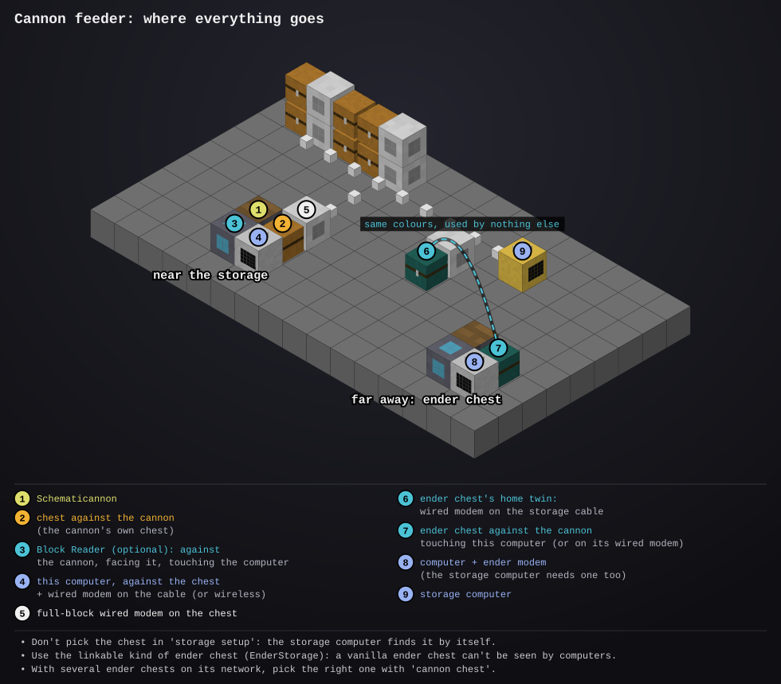

# cannon-feeder

- **Type:** computer (advanced is nicer: colour), plus a modem that reaches the [storage computer](../storage-computer/README.md): wired on its cable, or wireless / ender
- **Computer ID:** 
- **Label:** 
- **Location:** 
- **Peripherals:** a chest touching both this computer and the Create Schematicannon, on the storage cable (or an ender chest whose twin is); an Advanced Peripherals Block Reader facing the cannon (optional: it fetches what the cannon asks for by itself); a monitor (optional)

## What it does

Feeds a Create **Schematicannon** from your [storage
system](../storage-computer/README.md). The cannon takes its blocks, and its
gunpowder, from any chest touching it. This computer keeps that chest topped
up through the storage computer. It learns what to send in two ways, and you
can use either or both:

- **From the cannon itself**, with an Advanced Peripherals **Block Reader**
  facing it. CC can't ask the cannon anything, but the Block Reader reads its
  block data, which names the item it's stuck waiting for. That item is sent
  at once, and from then on it's kept topped up while the cannon works, so
  the cannon stops only once for each kind of block (never more in the
  chest than the blocks the cannon still has to place). When the cannon
  says it's finished, those items come off the list and what's left goes
  home.
- **From a list you give it:** each item and how many
  (`cannon add stone_bricks 340`), or every block a building plan from
  `/plans` uses (`cannon plan cottage`), with the amounts from the cannon's
  material list. Each is sent until the whole amount has gone, and never
  more, so the cannon has it before it asks and never stops for it. Only
  if the cannon then waits for one of them with none in the chest (the
  list said too few) is a stack more sent, no more than it has blocks left.

How the chest is kept:

- Every 5 seconds it asks the storage computer to top the chest up. Each item
  gets a fair share of the chest (up to 2 stacks), so the cannon always has
  some of everything to hand. It also tells the storage computer the most
  it may move of each, what's still to be sent, so the blocks the cannon
  uses while the request is on its way are never sent again.
- If the storage computer is slow to answer, it waits up to a minute for
  that answer before asking again, so nothing is sent twice.
- Anything storage hasn't got but can make is crafted on the way, by the
  [craft overseer](../craft-overseer/README.md) and its crafting turtles, the
  same as a builder turtle's order.
- It keeps 32 gunpowder in the chest while there's anything left to send,
  and whenever the cannon says it's out.
- Once everything is sent it stops. What the cannon didn't use stays in the
  chest while it's on the list; take it off the list (or clear it) and the
  storage computer puts it away within 10 minutes.

The monitor and the computer's own screen both lead with what's **missing
now**:

- At the top, the cannon (blocks placed of all, with a Block Reader) and what
  it's doing: placing, out of gunpowder, finished, or **waiting for** an
  item, and under it why that item isn't there yet: in the chest (it picks
  it up next), on its way, being crafted, or *none stored* and why it can't
  be crafted (no recipe, or what the recipe needs that isn't there).
- Below, **Missing now**: every item on the list that storage hasn't got
  enough of to send the rest, and can't make: how many are still needed,
  and *none stored*, *only 40 stored*, *crafting* or *can't* (and why).
  When there's nothing, it says so in green.
- The small print at the bottom: how much of the list has been sent, how
  many kinds are done, and the gunpowder in the chest.

Tap the monitor (or click the screen, or press Tab) for the **Sent** page:
each item, sent of needed (or how many were sent, for one the cannon asked
for; the one it's waiting for is orange), and whether it's *in chest*,
*crafting*, *none stored*, *can't* or *done*. Tap again to go back.

If the list has more kinds of item than the chest has slots, the first ones
on the list go in first and the rest wait their turn as those are used up.
A double chest holds 54 kinds.

## Files

- `cannon.lua`: the program. How much of each item it keeps in the chest is at the top.
- `startup.lua`: starts it on boot and restarts it if it stops (first it fetches any newer version from the website)
- [`lib/screen.lua`](../../lib/screen.lua): draws the screen without flashing (copy to `/lib/screen.lua`). Needed.
- [`lib/net.lua`](../../lib/net.lua): rednet requests and answers (copy to `/lib/net.lua`). Needed.
- [`lib/files.lua`](../../lib/files.lua): keeps the list across reboots (copy to `/lib/files.lua`). Needed.
- [`lib/claim.lua`](../../lib/claim.lua): tells the storage computer which chest is this feeder's (copy to `/lib/claim.lua`). Needed.
- [`lib/crafts.lua`](../../lib/crafts.lua): has the craft overseer make what storage hasn't got (copy to `/lib/crafts.lua`). Needed.
- [`lib/plan.lua`](../../lib/plan.lua): reads building plans for `cannon plan` (copy to `/lib/plan.lua`). Needed for `cannon plan`.
- [`lib/report.lua`](../../lib/report.lua): reports to the status server (copy to `/lib/report.lua`). Optional.
- [`lib/errlog.lua`](../../lib/errlog.lua): saves any error to `/errors.log` so you can read it later with `edit /errors.log` (copy to `/lib/errlog.lua`). Optional.
- `preview/`: the setup diagram (a picture, not installed)

## Setup



1. Put a **chest** against the Schematicannon, and this computer against the
   chest.
2. Join the chest to the storage system:
   - **Near the storage:** a full-block wired modem on the chest, on the
     storage cable (right-click it so it turns red). Give the computer a
     wired modem on the cable too, or a wireless one.
   - **Far away:** make the chest an **ender chest** (EnderStorage or the
     like) and put its twin (same colours, used by nothing else) on the
     storage cable with a wired modem. Give this computer and the storage
     computer an **ender modem**. A vanilla ender chest won't do: computers
     can't see into it. The ender chest can touch this computer, or sit on
     a wired modem of its own joined to this computer's (it's found if it's
     the only ender chest there; else pick it with `cannon chest`).

   Don't pick the chest in `storage setup`: the storage computer finds it by
   itself.
3. Install this program and reboot. The footer says what it's waiting for.
4. **With a Block Reader** (Advanced Peripherals): put it against the cannon,
   facing it, and touching this computer (or on its wired network). Load a
   schematic and start the cannon; that's all. The screen says "Cannon:
   placing" once it can see it.

   **Without one**, or so the cannon never stops to wait: read the cannon's
   material list and put the same on this computer's list, then start the
   cannon.

   ```
   cannon                       -- start (startup.lua does this on boot)
   cannon add stone_bricks 340  -- add 340 stone bricks to the list
   cannon add create:andesite_casing 12   -- a modded item: its full name
   cannon remove oak_planks     -- take an item off the list
   cannon plan cottage          -- add every block the plan /plans/cottage uses
   cannon list                  -- the list, and how much of each is sent
   cannon again                 -- send it all again (the same build once more)
   cannon clear                 -- forget the list (and what the cannon asked for)
   cannon chest                 -- pick the chest, if it touches more than one
   ```

   Stop it (hold Ctrl+T) to type these, or use them in a second shell on an
   advanced computer; it picks up the new list within 5 seconds.

## Things to know

- If the storage computer says it sent items that never turn up in the
  chest, three rounds running, the feeder takes it that the storage computer
  has the wrong chest for it (an ender chest whose twin is elsewhere) and
  finds its chest again ("finding my chest again"); what was sent to the
  wrong one goes back into storage.
- CC can't ask the cannon anything or read its schematic. The Block Reader
  only shows the item it's waiting for right now, so with a Block Reader
  alone the cannon stops once for each new kind of block while that's
  fetched (a few seconds, longer if it has to be crafted). A typed list
  avoids that.
- With several Block Readers about, it uses the one facing a
  Schematicannon; `set cannon.reader <name>` picks one.
- For the typed list, it counts what it has sent, not what the cannon used. Take items out of
  the chest yourself and it won't send them again (add them back with
  `cannon add`), unless the cannon is left waiting for one: then it sends a
  stack more. `cannon list` shows those extras.
- The storage computer needs to be up to date (`install update` on it, or
  a reboot) for the most-to-send limit; an older one ignores it and may
  send a little over the list as the cannon uses up the chest.
- `cannon plan` counts blocks, and a few items place two (doors, beds, tall
  flowers), so it may ask for more of those than the cannon uses. What's
  left goes back into storage once you clear the list.
- `set cannon.gunpowder 64` keeps more gunpowder in the chest, `0` none (fill
  the cannon yourself).
- **Which monitor.** It uses the first free monitor it finds, next to it or on its wired network. When several computers share a cable, they can take each other's: give this one its own with `set cannon.monitor monitor_3` (the name shows when you right-click the monitor's modem) and reboot. `set cannon.monitor none` keeps it off monitors.
