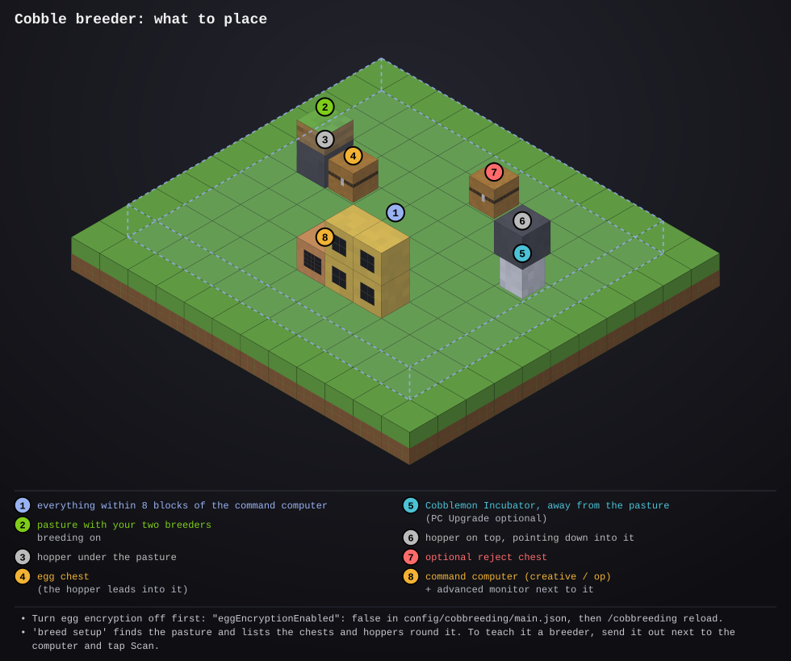

# cobble-breeder

- **Type:** command computer (creative, or given by an op)
- **Computer ID:** 
- **Label:** 
- **Location:** 
- **Peripherals:** advanced monitor (4 × 3 or bigger is best); optional wireless modem for the status server

## What it does

Breeds better and better Pokémon with
[Cobbreeding](https://modrinth.com/mod/cobbreeding) and the
[Cobblemon Incubator](https://modrinth.com/mod/cobblemon-incubator), working
towards a Pokémon with all six IVs at 31.

The pasture lays eggs and a hopper under it drops them into the **egg
chest**. Every few seconds the breeder reads each egg's IVs, nature and
gender before it hatches, and compares it with the breeder it would replace.
That's the weakest breeder that isn't a Ditto. Without a Ditto in the pasture
it only compares with breeders of the egg's gender, so you keep a male and a
female.

- **Better** (a higher IV total, by default): the egg goes to the hopper that
  feeds the **incubator**. The monitor turns orange and tells you which
  breeder to recall and that the new one goes in once it hatches. Later eggs
  have to beat that new one, so every swap is a step up.
- **Shiny:** hatched anyway, but no swap.
- **Not better:** goes to the **reject chest**, or is deleted or hatched
  anyway, whichever you pick in setup.

ComputerCraft can't put a Pokémon into a pasture or take one out, so **you
make each swap yourself**. In the pasture, recall the old breeder and add the
new one from your PC. The breeder sees the pasture change and from then on
counts the new one as the breeder, with the IVs its egg had. You don't need
to scan it.

The monitor shows:

- **To 6x31:** how close your best breeder (not counting a Ditto) is to
  perfect, as a bar and a percentage of the 186 IV points.
- **The pair row:** the best of each stat across all the breeders, which is
  what the eggs can inherit.
- **A card per breeder:** species, gender, nature, six IV bars (lime for 31,
  yellow 25+, orange 15+, red below), and the total.
- **The swap to make,** or what it's waiting for.
- **The last eggs:** six IVs, the total and what happened to each egg
  (KEEP, SHINY, rej, hatch), with counts and the best egg so far.
- **Scan** and **Pause** buttons.

## Files

- `breed.lua`: the program. How often it looks and how far setup searches are at the top.
- `config.lua`: what counts as better, shiny eggs, a nature to breed for, the scan range and the text size. `install update` never replaces it.
- `startup.lua`: runs the breeder on boot once it's set up, and restarts it if it stops (first it fetches any newer version from the website).
- [`lib/screen.lua`](../../lib/screen.lua): draws the screen without flashing (copy to `/lib/screen.lua`). Needed.
- [`lib/files.lua`](../../lib/files.lua): saves the setup, the breeders and the egg history (copy to `/lib/files.lua`). Needed.
- [`lib/report.lua`](../../lib/report.lua): reports to the status server (copy to `/lib/report.lua`). Optional; it works without it.
- [`lib/errlog.lua`](../../lib/errlog.lua): saves any error to `/errors.log` so you can read it later with `edit /errors.log` (copy to `/lib/errlog.lua`). Optional.
- `preview/`: the setup diagram (a picture, not installed)

## Setup



1. **Turn egg encryption off.** By default Cobbreeding scrambles what's in
   an egg so nothing can read it before it hatches. In
   `config/cobbreeding/main.json` on the server (or the world folder in
   single player), set `"eggEncryptionEnabled": false`, then run
   `/cobbreeding reload`. Eggs laid before that stay unreadable: hatch them
   by hand.
2. Put your two breeders in a **pasture** and turn breeding on. Place a
   **hopper** under the pasture, leading into a chest: the **egg chest**.
3. Place the **Cobblemon Incubator** with a **hopper** on top of it, pointing
   down into it. Keep the incubator away from the pasture (or set
   `autoInputFromPastures` to false in its config). Otherwise it pulls eggs
   straight from the pasture and nothing gets judged. A **PC Upgrade** in the
   incubator sends what hatches to your PC.
4. Optional: a **reject chest** for eggs that aren't better.
5. Place a **command computer** within 8 blocks of all of them, with an
   advanced monitor next to it. Command computers can only be placed in
   creative, or given by an op with
   `/give @p computercraft:computer_command`.
6. Install, then run `breed setup`. It finds the pasture and lists every
   chest and hopper around it with its coordinates. Pick the egg chest, the
   incubator's hopper, and the reject chest (or `delete`, or `hatch`). You
   can also type `x y z` for any of them.
7. **Teach it your breeders.** A Pokémon in a pasture has no data the game
   shows, so the breeder learns each one once. Recall it, send it out next to
   the computer, tap **Scan** (or type `breed scan`), and put it back. Or
   type its IVs: `breed ivs 1 31 20 31 14 25 31`. Until every breeder is
   known, eggs wait in the egg chest.

```
breed setup                         -- find the pasture and chests, pick each
breed                               -- run it (startup.lua does this on boot once set up)
breed scan                          -- read the Pokemon sent out next to the computer
breed ivs 2 31 31 28 31 30 31       -- type breeder 2's IVs: hp atk def spa spd spe
breed monitor                       -- pick the monitor
breed forget                        -- forget the egg history and the best egg
edit config.lua                     -- what counts as better, shiny eggs, a nature
```

## Things to know

- **Scoring.** By default an egg is better when its six IVs add up to more
  than the breeder's. With `score = "perfect"` in `config.lua` more 31s wins
  first, then the total. `minGain` sets how much higher the total must be.
  With `nature = "adamant"`, only Adamant eggs can replace a breeder.
- **A Destiny Knot** on a breeder passes 5 of the parents' 12 IVs instead of
  3, so progress is much faster. An Everstone passes its nature.
- **Swaps are followed, not seen.** When a breeder with a swap waiting
  leaves the pasture and a Pokémon it doesn't know arrives, the breeder takes
  it to be the egg it kept. The card says "(from egg)". If you put in a
  different one, Scan it so the numbers are right.
- **Scan** reads your Pokémon sent out within 8 blocks of the computer
  (`scanRange` in `config.lua`). Wild ones nearby get scanned too, which is
  harmless: only a Pokémon that's in the pasture is ever used. A Pokémon
  whose data it couldn't read is counted on screen, and its data is saved
  in `/errors.log`.
- **Hatching.** Kept eggs hatch in the incubator. With a PC Upgrade they go
  to your PC, so look for the one with the IVs on the monitor (the summary
  screen shows IVs). Several kept eggs can be waiting: the monitor always
  names the best one for each breeder.
- **A full hopper or chest** pauses the judging ("FULL") until there's room.
  Eggs stay safe in the egg chest, and the pasture holds 5 more.
- **Pause** keeps every egg in the egg chest, for when you want to collect
  them by hand.
- Keep the computer, pasture and chests in the same loaded chunks. When the
  pasture's chunk unloads, it stops laying anyway.
- **Which monitor.** It uses the first monitor it finds, next to it or on
  its wired network. Give it its own with `breed monitor` (or
  `set breed.monitor monitor_3`), or `none` to keep it on the computer's
  screen.
