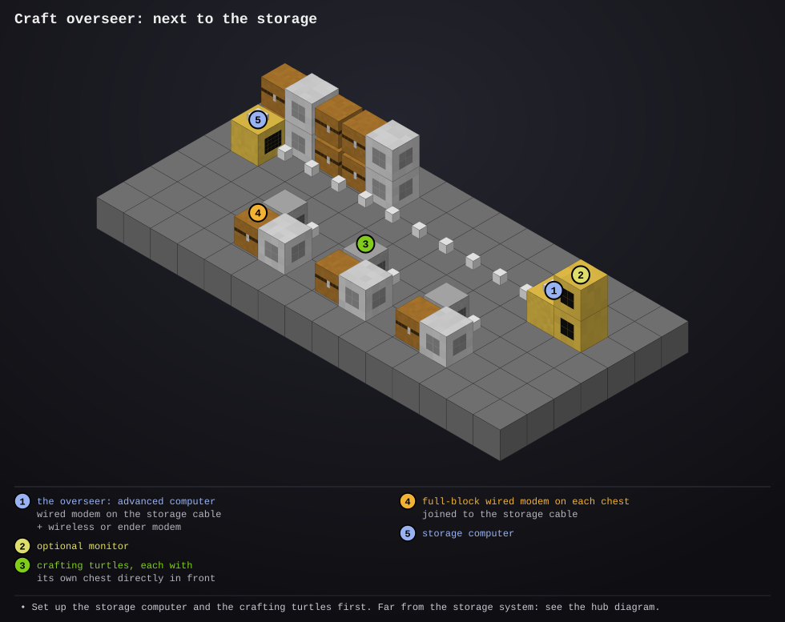
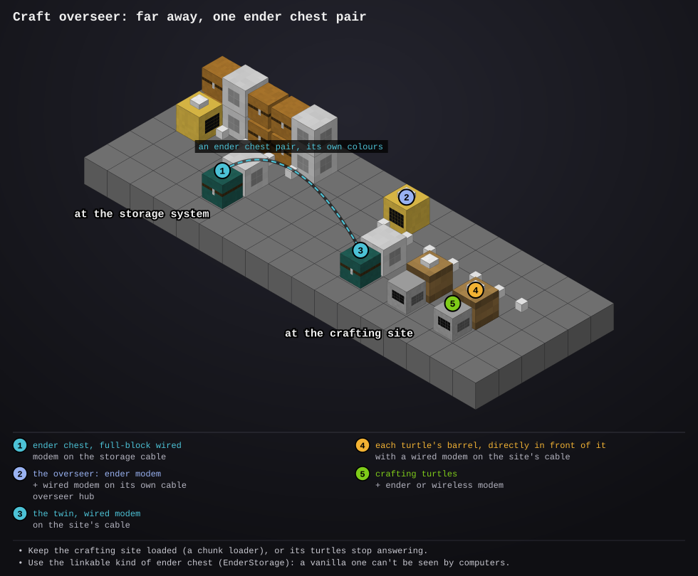

# craft-overseer

- **Type:** advanced computer, with a wired modem on the storage system's cable and a wireless or ender modem (turtles and far-away computers ask it about crafting); or far away, with an ender modem and an ender chest (see [Far from the storage system](#far-from-the-storage-system))
- **Computer ID:** 
- **Label:** 
- **Location:** 
- **Peripherals:** advanced monitor (optional, 2 wide by 2 high or bigger), wired modem, wireless modem

## What it does

The [storage system's](../storage-computer/README.md) recipe server: it
knows every recipe, plans every craft, and runs them on as many
[crafting turtles](../crafter-turtle/README.md) as you like. The storage
computer only keeps items and knows no recipes, so a modpack's thousands of
them never slow down item requests.

When something is asked for that isn't stored but could be made from what
is, this computer plans it. When the village builder asks for 40 jungle
fences and there are none, but there are jungle logs, it plans logs into
planks, planks into sticks, then the fences, and:

1. Each job goes to a free crafting turtle. Steps of one order run in turn
   (planks before sticks, sticks before fences); different orders run side by
   side on different turtles.
2. For each batch it has the storage computer load that turtle's chest,
   tells the turtle to craft, and has the chest emptied back into storage.
3. The results go into storage like anything else, and whoever asked gets
   them on their next request. It never crafts the same order twice while
   one is already being made.

Who asks it (every program does it through
[`lib/crafts.lua`](../../lib/crafts.lua)):

- the [village builder](../village-turtle/README.md), the
  [builder](../builder-turtle/README.md), the
  [cannon feeder](../cannon-feeder/README.md) and the
  [remote terminal](../remote-terminal/README.md): when the storage computer
  sends them less than they asked for and the rest isn't stored, they have it
  made here. When they ask how much there is, what could be made counts too.
  The village builder has a building's materials started while it clears the plot.
- the [craft terminal](../craft-terminal/README.md): this computer works out
  its list of everything that can be made, with how many, and makes its
  orders; what's made goes into the terminal's chest through the storage
  computer. With a big modpack counting everything takes a while (around a
  minute with a few thousand recipes), so it then waits three times as long
  as the last count took before counting again.
- the [factory](../factory/README.md): its botany pots, cooking pots and
  enricher have their ingredients made here; its
  [furnaces](../factory/README.md#smelting-on-request),
  [infusers](../factory/README.md#infusing) and
  [essence farm](../factory/README.md#essence-farm) tell it what they can make,
  and run those steps of a plan ("Asked factory #9 to make 64 stone.").
  The crafting turtles take the later steps once it's in storage.
- [`crafter learn`](../crafter-turtle/README.md) on a crafting turtle: a new
  recipe, saved here in `/.overseer_recipes`.

With an [ME or RS system](../storage-computer/README.md#me-and-rs-systems)
behind the storage computer, anything the system has a pattern for is made
by the system instead (the storage computer starts it).

If there isn't enough to make the whole order, it makes as many as it can
(whoever asked gets those, and is told why not the rest). If no crafting
turtle is running, those waiting are told that crafting is stuck, and it
carries on by itself once one is back.

The monitor (or the computer's own screen, without one) has three tabs at
the top: **Queue**, **Turtles** and **Craft**.

- **Queue:** every job in order, with how many it makes and its state:
  *queued*, *on #12* (being crafted), *missing* (storage hasn't got enough
  for it yet, counting what the jobs before it use and make) or *short*
  (it tried to load and came up short). A job that's missing anything has a
  line under it saying what, e.g. "needs 3 iron ingot, 2 stick". Under the
  queue, how many turtles are working, idle or not ready, and the last thing
  that happened.
- **Turtles:** each crafting turtle, with its label, what it's doing ("crafting
  64 oak planks", *idle*), its chest and how much it has made. One that
  stopped answering shows *not answering* in red and for how long; one
  that answers but has no chest yet shows *no chest yet*.
- **Craft:** order things made (see [Ordering crafts here](#ordering-crafts-here)).

A job can come up short when something else (a builder, the cannon feeder)
took ingredients it was counting on: it then has those made too, as a new
job, and the short one tries again every 15 seconds. A job that stays short
of ingredients for 10 minutes is given up on, along with the rest of its
order.

### Turtles coming and going

- A crafting turtle says hello when it starts, so it's put to work within a
  few seconds ("Crafting turtle #12 is ready."), not at the next look.
- One that restarts in the middle of a craft (a reboot, its chunk reloading)
  says so as it starts: that batch is tried again straight away instead of
  waiting a minute for an answer that won't come.
- One that stops answering is left out (its job goes to another turtle) and
  stays on the Turtles tab as *not answering* for 30 minutes. When it
  answers again it's checked with a ping and goes back to work
  ("Crafting turtle #12 is back.").
- Turtles are looked for every 15 seconds anyway, so older crafting turtles
  that don't say hello still join.

### Ordering crafts here

The **Craft** tab lists everything that can be made from what's stored, A
to Z, with how many could be made and how many are stored already, and
orders it (no [craft terminal](../craft-terminal/README.md) needed). What's
made goes into storage; take it out at the storage computer's terminal.

- **On the monitor:** tap a row, set how many with the -64 -8 -1 +1 +8 +64
  buttons (it starts at a stack, or as many as can be made if that's fewer),
  then tap **Craft** (or **x** to cancel). The arrows at the top turn the pages.
- **On the computer's screen:** type to search, Up and Down to pick, Enter,
  type how many (or leave the stack), Enter again. Tab goes to the next
  tab, and clicking a tab works too. With a monitor attached, the computer's screen starts on
  the Craft tab, so the monitor can keep showing the queue.

The order is planned like any other ("Crafting 64 torch into storage." at
the bottom, or why it can't be). With a big modpack the list takes a while
to work out the first time the tab is opened ("Working out what can be
crafted..."), and is counted again now and then while the tab is open.

### Recipes

The recipes are in `recipes.lua`: everything craftable that the village
themes use, the usual basics, and the stairs, slabs and walls of the vanilla
stone, brick, deepslate, blackstone and tuff families (mossy stone bricks
too). Teach it more with `crafter learn` on a crafting turtle. For every
recipe in your modpack, see [Modded recipes](#modded-recipes).

Smelting isn't crafting, but the [factory's furnaces](../factory/README.md#smelting-on-request)
take requests: the factory tells the craft overseer what they can smelt
(stone, glass, charcoal, smooth stone, bricks, ingots...), so a plan that
needs stone smelts cobblestone first, and asking for stone gets it made.
Ores and raw food are [smelted](../factory/README.md#smelting) as they come in.

### Modded recipes

CC can't read the game's recipe book, but every vanilla and mod recipe is
stored in the mod files, and [`tools/recipes.mjs`](../../tools/recipes.mjs)
pulls out all the crafting-table ones (shaped and shapeless, with tags like
"any planks"). Machine recipes (Create, Botany Pots and so on) are left out:
the crafting turtles can't make those. The result is one file,
`pack_recipes.lua`, which this computer loads next to `recipes.lua` when it
starts.

For the TRekt Mons pack the file is already made (8,400 recipes, 680 KB,
Mystical Agriculture's essence recipes included, for the
[essence farm](../factory/README.md#essence-farm)). On this computer:

```
wget https://rakeki.github.io/Rakeki-s-ComputerCraft/computers/craft-overseer/packs/trekt-mons.lua pack_recipes.lua
reboot
```

For another pack, or after adding mods, run this on your PC (it needs
Node.js) and copy the file it writes onto this computer as
`pack_recipes.lua` (dragging a file onto an open computer screen uploads
it):

```
node tools/recipes.mjs pack_recipes.lua <the Minecraft version jar> <your mods folder>
```

`install update` never touches `pack_recipes.lua`. A computer has 1 MB of
disk by default, so a file much bigger than about 700 KB won't fit next to
the programs. One that used to be on the storage computer: move it here (the
storage computer's footer says so while it's there).

## Files

- `overseer.lua`: the program. How many turtles it uses and how long it waits are at the top.
- `crafting.lua`: works out what to craft, ingredients first
- `recipes.lua`: the built-in recipes
- `pack_recipes.lua`: optional, every crafting recipe in your modpack (see [Modded recipes](#modded-recipes)); `packs/` has ready-made ones
- `startup.lua`: starts it on boot and restarts it if it stops (first it fetches any newer version from the website)
- [`lib/screen.lua`](../../lib/screen.lua): draws the monitor without flashing (copy to `/lib/screen.lua`). Needed.
- [`lib/report.lua`](../../lib/report.lua): reports to the status server (copy to `/lib/report.lua`). Optional.
- [`lib/errlog.lua`](../../lib/errlog.lua): saves any error to `/errors.log` so you can read it later with `edit /errors.log` (copy to `/lib/errlog.lua`). Optional.
- [`lib/net.lua`](../../lib/net.lua): rednet requests and answers (copy to `/lib/net.lua`). Needed.
- [`lib/files.lua`](../../lib/files.lua): crash-safe save files (copy to `/lib/files.lua`). Needed.
- [`lib/claim.lua`](../../lib/claim.lua): tells the storage computer which chest is its ender chest's twin, when it has one (copy to `/lib/claim.lua`). Needed.
- `preview/`: the setup diagrams (pictures, not installed)

## Setup



1. Set up the [storage computer](../storage-computer/README.md) first.
2. Place an advanced computer with a **wired modem** joined to the storage
   cable (right-click it so it turns red), and a **wireless or ender modem**:
   turtles and far-away computers ask it about crafting, and crafting turtles
   that use wireless take their jobs over it. A monitor next to it is optional.
3. Set up one or more [crafting turtles](../crafter-turtle/README.md), each
   with **its own chest** in front of it on the storage cable. Each tells the
   storage computer which chest is its own when it starts.
4. Install this program on the computer and reboot it. With a modpack, put
   its `pack_recipes.lua` here first (see [Modded recipes](#modded-recipes)).
   It says "Ready: 2 crafting turtles." once it has found them.

   ```
   overseer                  -- start (startup.lua does this on boot)
   overseer clear            -- forget the queue
   overseer hub              -- use the ender chest on my cable (see below)
   overseer hub <name>       -- that one, when there are several
   overseer hub off          -- stop using it
   ```

## Far from the storage system



The crafting turtles can work somewhere else entirely (another base,
another dimension) with **one pair of ender chests** for all of them:

1. At the storage system: one ender chest of the pair, with a **full-block
   wired modem** on it, on the storage cable (right-click the modem so it
   turns red). Give the pair its own colours: nothing else may use them.
2. At the crafting site: the overseer computer with an **ender modem** (it
   reaches the storage computer and the turtles from anywhere) and a
   **wired modem**, and its own cable joining:
   - the other ender chest of the pair, with a wired modem on it;
   - each crafting turtle's **barrel** (or chest), directly in front of the
     turtle (or below or above it), with a wired modem on it.
3. Each crafting turtle needs an ender or wireless modem too.
4. On the overseer, type `overseer hub` (it picks the ender chest on its
   cable, or lists them if there are several), then reboot it. It tells the
   storage computer which chest is the twin of its ender chest (the storage
   footer says "Craft overseer #5's ender chest is ..."), and each turtle
   asks it which barrel is its own when it starts ("The craft overseer uses
   my chest (...)").

For each batch the storage computer loads the ender chest, the overseer
moves it into that turtle's barrel, the turtle crafts, and the overseer
sends what it made back through the ender chest. One batch passes through
the ender chest at a time, but the turtles still craft side by side.

The crafting site has to stay loaded (a chunk loader), or the turtles stop
answering and their jobs wait. Turtles on the storage cable still work as
before alongside the far-away ones.

## Things to know

- Without an overseer nothing is crafted: the storage computer only keeps
  items. Programs that ask for something that isn't stored say "no craft
  overseer answered" and carry on with what there is.
- Use one craft overseer per storage system: two would each plan from the
  same stock.
- The queue is saved, so a reboot carries on where it was. A batch cut short
  by the reboot has its chest emptied before it's loaded again. Recipes
  taught with `crafter learn` before this computer took the recipes over were
  saved on the storage computer: teach them again here.
- The ME or RS system's own crafting (with a bridge) isn't shown in the
  queue: the storage computer has the system make it.
- Up to 8 turtles are used at once (`MAX_CRAFTERS` at the top of
  `overseer.lua`).
- `storage test` on the storage computer says whether it found the overseer,
  and lists every crafting turtle and its chest.
- **Which monitor.** It uses a monitor touching it, never one on the cable by itself: the storage computer's monitor is usually there. To use one on the cable, name it with `set overseer.monitor monitor_3` (the name shows when you right-click the monitor's modem) and reboot. `set overseer.monitor none` keeps it off monitors.
