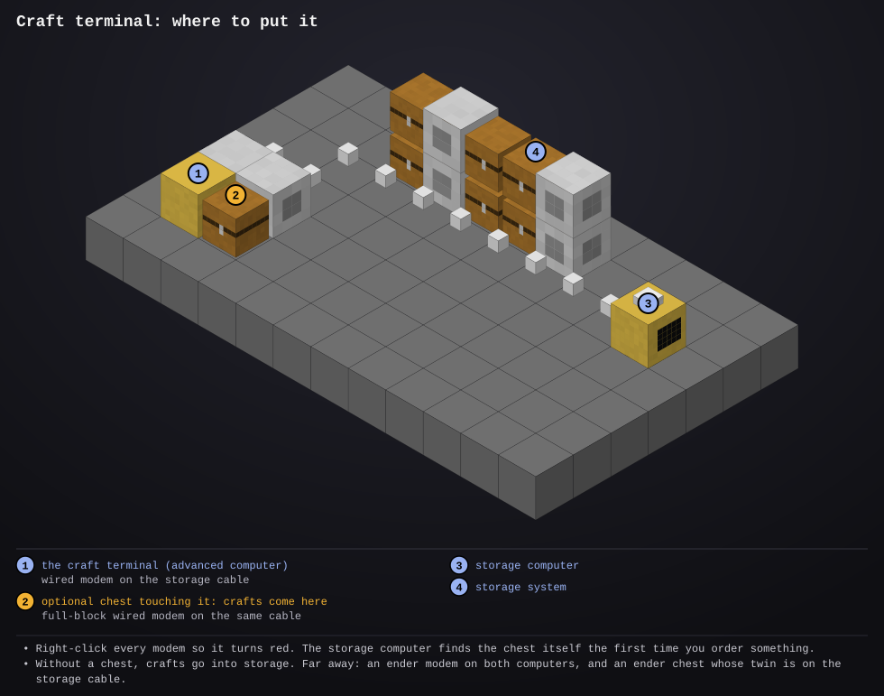

# craft-terminal

- **Type:** computer (advanced is nicer: colour and mouse), plus a wired modem on the storage cable (or a wireless or ender modem)
- **Computer ID:** 
- **Label:** 
- **Location:** 
- **Peripherals:** wired modem joined to the [storage system's](../storage-computer/README.md) cable; optional chest next to it, with a wired modem on the same cable, for the crafts to come to

## What it does

A computer just for having things crafted. The
[storage computer](../storage-computer/README.md) (or a
[remote terminal](../remote-terminal/README.md)) stays the place to see and
take what's stored; this one lists everything the storage system can make
from what's stored, and orders it.

- **The list.** Every item it could craft, A to Z, with how many it could
  make ("make 40") and how many are stored already ("12 stored"). Type to
  search, by name. Items an ME or RS system has a pattern for say
  "pattern".
- **Ordering.** Pick an item with the arrow keys (or click it) and press
  **Enter**: it asks how many, starting at a stack (or as many as can be
  made, if that's fewer). Type a number and press Enter again. **Right**
  orders just one. The storage computer plans the crafts and its
  [crafting turtles](../crafter-turtle/README.md) (or the ME / RS system)
  make them, a stack of planks or sticks first if that's what it takes.
- **Where they go.** With a chest next to this computer, crafts come to that
  chest as they're made. Without one (or after **Tab**, which switches),
  they stay in storage. The top right says which: "to the chest (left)",
  "to chest_5" (one picked with `crafts chest`) or "into storage".
- **What's being made.** The line above the message shows what's being
  crafted right now ("Making: 64 Torch, 16 Chest"), or why crafting is
  stuck. The message line says when an order has all arrived in the chest.

Ordering something that's already stored makes that many more: with a chest,
the ones stored are sent at once and the new ones top storage back up.

The list is worked out by the storage computer while a craft terminal is
running, again within 30 seconds of anything stored changing. With a big
modpack the first list can take a little while; the screen says "Working
out what can be crafted..." until it's there, and after that the list is
counted again less often (three times as long as the last count took), so
the storage system isn't kept busy counting.

With a wireless modem it also reports to the
[status server](../status-server/README.md).

## Files

- `crafts.lua`: the program
- `startup.lua`: starts it on boot and restarts it if it stops (first it fetches any newer version from the website)
- [`lib/screen.lua`](../../lib/screen.lua): draws the screen without flashing (copy to `/lib/screen.lua`). Needed.
- [`lib/net.lua`](../../lib/net.lua): rednet requests and answers (copy to `/lib/net.lua`). Needed.
- [`lib/files.lua`](../../lib/files.lua): remembers which chest to use (copy to `/lib/files.lua`). Needed.
- [`lib/claim.lua`](../../lib/claim.lua): tells the storage computer which chest is this terminal's (copy to `/lib/claim.lua`). Needed.
- [`lib/report.lua`](../../lib/report.lua): reports to the status server (copy to `/lib/report.lua`). Optional.
- [`lib/errlog.lua`](../../lib/errlog.lua): saves any error to `/errors.log` so you can read it later with `edit /errors.log` (copy to `/lib/errlog.lua`). Optional.
- `preview/`: the setup diagram (a picture, not installed)

## Setup



1. Update the [storage system](../storage-computer/README.md) (`install
   update`): older ones don't answer a craft terminal. It needs a way to
   craft: a [crafting turtle](../crafter-turtle/README.md), or an ME or RS
   system with patterns.
2. Put this computer by the storage system with a **wired modem** on it,
   joined to the storage cable. Right-click the modem so it turns red.
3. Optional: put a chest touching the computer, with a **full-block wired
   modem** (or a small one on a barrel) on the same cable, also red. Crafts
   come here. Don't pick it as anything in `storage setup`: the storage
   computer finds it by itself the first time you order something.
4. Install the program and reboot.

   ```
   crafts                    -- start (startup.lua does this on boot)
   crafts make 64 torch      -- craft 64 of the first craftable item matching "torch"
   crafts chest              -- pick the chest crafts go to, from a list
   crafts chest none         -- keep crafts in storage, even with a chest next to me
   ```

On the terminal: type to search, **Up** / **Down** to pick, **Enter** to
order (then type how many, Enter), **Right** for one, **Tab** to switch
between the chest and storage, **Delete** to clear the search. While it asks
how many, Backspace rubs out and on an empty number closes the question.

## Things to know

- Far from the storage system it works over an **ender modem** (on both
  computers) instead of the cable, and the chest can be a linked ender chest
  whose twin is on the storage cable, as for a
  [remote terminal](../remote-terminal/README.md). Use colours of its own.
- What came to the chest waits there for 10 minutes; anything still there
  after that, and anything you drop in yourself, goes back into storage.
- If there isn't enough to make the whole order, it makes as many as it can
  and says so ("Crafting 12 Chest: it comes to the chest (only enough to
  make 12)").
- A chest touching the computer is used without asking. If there's more
  than one, or the chest is elsewhere on the cable, pick it with `crafts
  chest`.
- Several craft terminals can share one storage system; each has its own
  chest.
