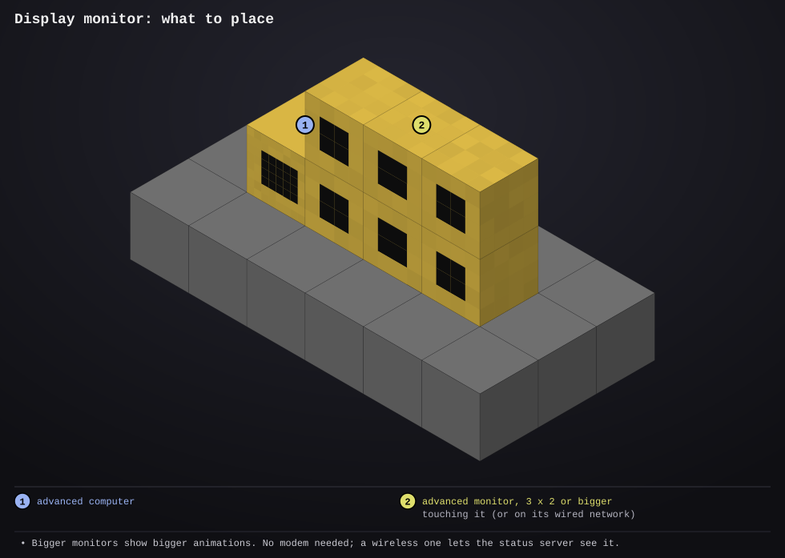

# display-monitor

- **Type:** advanced computer with an advanced monitor (without one it uses the computer's own screen)
- **Computer ID:** 
- **Label:** 
- **Location:** 
- **Peripherals:** advanced monitor, touching the computer or on its wired network

## What it does

A monitor that's only there to look good. It plays animations on a loop
and changes to the next one every hour.

The animations don't come with it: you install the ones you want from the
website, the same way as building plans (`install animations` lists them,
`install animation <name>` adds one). Each is a file in `/animations`. The
display goes through them in name order, picks up new ones within a few
seconds of installing them, and remembers which one was on (and since when)
across reboots, so a restart doesn't start the hour again. Installed
animations update on boot like programs do.

Each animation is drawn for the monitor it's on: pixel art is made bigger
in whole steps to the largest size that fits, and animations drawn by code
(like the Pikachu dance) fill the whole screen. A broken animation file is
skipped (and noted in `/errors.log`); with nothing to show, the monitor says
how to install some.

Animations so far (the website plays each one on the program's page):

- **pikachu-dance**: Pikachu dancing under a spotlight on a disco floor
- **campfire**: a fire flickering in the dark
- **dino-run**: a little dinosaur running through the desert, jumping cacti
- **dancing-banana**: a banana wiggling, waving and kicking in front of sliding stripes
- **turtle-meadow**: ComputerCraft turtles pottering across a meadow of flowers
- **trex-grabber**: a T-rex in sunglasses fetching a cookie with an extendo grabber
- **dvd-bounce**: the DVD logo bouncing round the screen, a new colour every bounce

## Files

- `display.lua`: the program. The rotation time and folder are at the top.
- `anim.lua`: loads an animation and paints its frames for the screen; the website runs this same file to preview them
- `startup.lua`: runs on boot: fetches any newer version from the website (and of each animation), then starts the display and restarts it if it ever stops
- [`lib/screen.lua`](../../lib/screen.lua): draws each frame without flashing and finds the monitor (copy to `/lib/screen.lua`)
- [`lib/files.lua`](../../lib/files.lua): saves which animation is on, safely (copy to `/lib/files.lua`)
- [`lib/report.lua`](../../lib/report.lua): optional; tells the [status server](../status-server/README.md) which animation is on, if there's a wireless modem (copy to `/lib/report.lua`)
- [`lib/errlog.lua`](../../lib/errlog.lua): saves any error, and animations it couldn't show, to `/errors.log` (copy to `/lib/errlog.lua`)
- `preview/setup.svg`: where to put the computer and monitor

## Setup



1. Place an advanced computer.
2. Put an advanced monitor against any side of it. A monitor further away
   works too: put a wired modem on the computer and on the monitor, join them
   with cable and right-click both modems.
3. Install the display, then the animations you want, and reboot.

```
install display-monitor                       -- the program
install animations                            -- list the animations you can install
install animation dino-run dvd-bounce         -- install some (one or several)
install remove animation campfire             -- take one off again
display                                       -- start showing (startup.lua runs it on boot)
display list                                  -- the animations here, and which one is on
display next                                  -- show the next one now
display show campfire                         -- show this one now (its hour starts now)
display every 30                              -- change animation every 30 minutes instead of 60
display monitor                               -- pick which monitor to use
```

## Making an animation

An animation is a Lua file in `animations/` in this repo (listed under
`animations` in `site/programs.json`), returning a table. It runs with
nothing but `math`, `string` and `table`, so it can't touch the computer.
[`campfire.lua`](../../animations/campfire.lua) is the simple kind:

```lua
return {
  title = "Campfire",
  frameTime = 0.25,             -- seconds per frame
  frames = {                    -- each frame: rows of letters, one per pixel
    { "...1...", "..141..", ".cc.cc." },
    { "..1....", "..141..", ".cc.cc." },
  },
  colours = { Y = "4" },        -- optional: your own letters for blit colours
  background = "f",             -- colour of "." and around the art
}
```

The letters are CC's blit colours (`0` white, `1` orange, `4` yellow, `e`
red, `c` brown, `f` black...), and each pixel is two characters wide so it
comes out about square. For anything else, give `length` (frames in the
loop) and `draw = function(t, w, h)`, returning one `{ text, fg, bg }` blit
row per line of the screen. `canvas` does the sums: `canvas.new(w, h, 28, 20)`
gives a grid of pixels covering the screen, made bigger in whole steps while a
28 x 20 picture still fits, with `fill`, `set`, `rect`, `sprite` (rows of
letters, like the pixel art), `char` and `rows()` to return:

```lua
local function draw(t, w, h)
  local c = canvas.new(w, h, 24, 16)
  c:fill("f")
  c:sprite(1 + t, 3, { ".44.", "4444", ".44." })   -- a yellow blob moving right
  return c:rows()
end
return { title = "Blob", length = 8, frameTime = 0.2, draw = draw }
```

[`dino-run.lua`](../../animations/dino-run.lua) and the others are built that
way. Make the last frame lead into the first and it loops without a jump; for
something that crosses the screen, work its path out from `w` so it goes a
whole number of times round in a loop (`turtle-meadow`, `dvd-bounce`).

## Things to know

- With several monitors around, it takes one touching the computer first,
  else the first on the cable; `display monitor` picks another.
- With one animation installed, it just keeps playing that one.
- A computer that had the old pokemon-dance program becomes this one on its
  next update; install `pikachu-dance` to keep Pikachu dancing.
- Hold Ctrl+T on the computer to stop it; reboot to start again.
