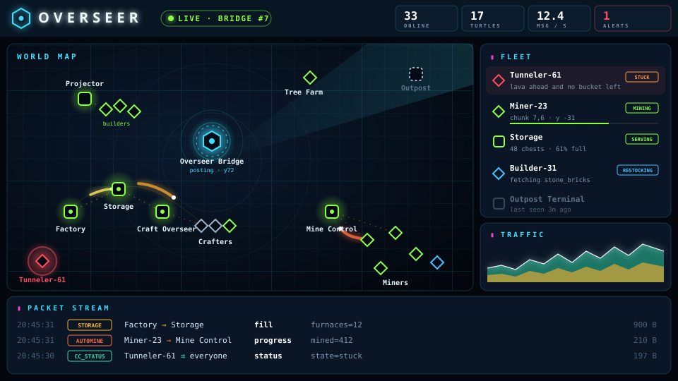
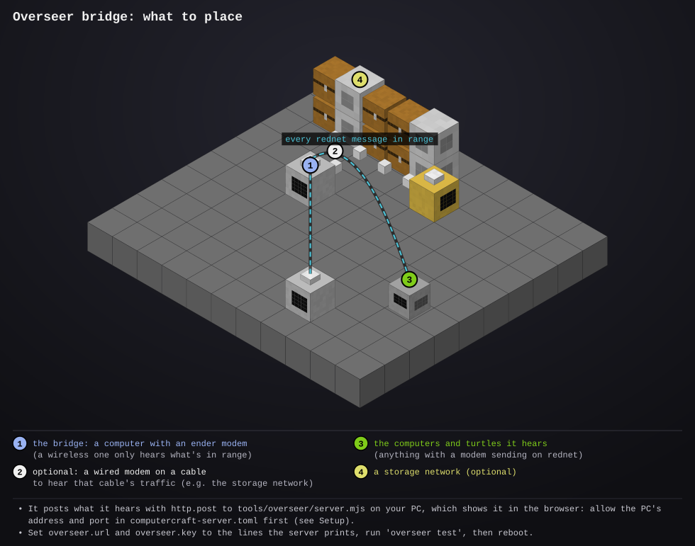

# overseer-bridge

- **Type:** computer (any kind), plus an ender modem (or a wireless one) to listen with
- **Computer ID:** 
- **Label:** 
- **Location:** 
- **Peripherals:** ender or wireless modem; optionally a wired modem on a cable you also want to hear

## What it does

The overseer is a live map of your whole ComputerCraft network in your web
browser. Every computer and turtle shows up where it is in the world, coloured
by what it's doing (mining, building, waiting, stuck, offline), and every
rednet message between them flies across the map as a glowing streak,
coloured by protocol. Around the map there's a fleet list you can search, a
traffic chart of the last two minutes, a scrolling log of every message (who
sent it to whom, what kind, how big), and a detail panel for whatever you
click: position, fuel, uptime, who it talks to and what it's been up to.



It comes in two halves:

- **This computer, the bridge**, sits in your base and listens. Rednet sends
  every message on a shared "repeat" channel as well as to its recipient, so
  the bridge hears all traffic in range without any other program changing.
  With an ender modem that's everything, everywhere. It also hears each
  computer's status report (everything that uses
  [`lib/report.lua`](../../lib/report.lua), which is every program here).
  About once a second it posts what it heard to the overseer server.
- **The overseer server**, [`tools/overseer/server.mjs`](../../tools/overseer/server.mjs),
  runs on your PC. It keeps the latest state of every computer, saves where
  each was last seen, and serves the overseer page to your browser.

The bridge holds up to 2000 messages while the server can't be reached and
sends them when it's back; past that it drops the oldest. A computer that
stops reporting shows as offline after 30 seconds. A computer that only sends
or receives messages but never reports its status (it doesn't use
`lib/report.lua`) still appears, as a dashed "heard only" marker. Computers
without GPS circle the bridge on a dashed ring, marked "no GPS".

You can try the page without Minecraft: [open the demo](../../tools/overseer/public/index.html).
With no server behind it, the page plays a made-up base.

## Files

- `overseer.lua`: the bridge. `overseer` runs it, `overseer test` checks the server answers.
- `startup.lua`: runs on boot: fetches any newer version from the website, then keeps the bridge running.
- [`tools/overseer/server.mjs`](../../tools/overseer/server.mjs): the server, for your PC (Node.js, nothing else to install).
- [`tools/overseer/public/`](../../tools/overseer/public/index.html): the page it serves (`index.html`, `app.js`, `style.css`, `demo.js`).
- `tools/overseer/data/`: made by the server: `config.json` (port, address, key) and `state.json` (every computer it has seen).
- `preview/`: pictures of the page and the setup (not installed)

## Setup



These steps are for the usual case: Minecraft (single player, or a server you
run yourself) on the same PC as the overseer server. See
[Hosting it elsewhere](#hosting-it-elsewhere) for the others.

1. Install [Node.js](https://nodejs.org) (18 or newer) on your PC, and get this
   repository (or just the `tools/overseer` folder from the website).
2. Start the server. The first time, it makes a key and prints the two `set`
   lines for the bridge:
   ```
   node tools/overseer/server.mjs
   ```
3. Let ComputerCraft reach your PC. CC blocks local addresses by default, so
   open `computercraft-server.toml` (in `saves/<world>/serverconfig/` for
   single player, `world/serverconfig/` on a server) and add this rule
   **above** the `$private` rule, then restart the world:
   ```toml
   [[http.rules]]
   host = "127.0.0.1"
   port = 8090
   action = "allow"
   ```
   The `port` keeps it to the overseer: computers still can't reach anything
   else on your PC.
4. Place a computer with an ender modem (a wireless one only hears what's in
   range). Add a wired modem too if you want to hear a cable's traffic, like the
   storage network's.
5. Install the bridge, type the lines the server printed, test, and reboot.
6. Open http://localhost:8090 in your browser.

```
wget run <site>/install.lua overseer-bridge
set overseer.url http://127.0.0.1:8090    -- what the server printed
set overseer.key <the key>                -- what the server printed
overseer test                             -- "The overseer server answered. All good!"
reboot                                    -- the bridge starts and keeps running
```

On the page: drag to pan, scroll or pinch to zoom, click a computer for its
details, double-click to zoom in on it. **F** fits everything in view, **T**
turns trails on and off, **H** status heartbeats, **L** labels, **Space**
pauses the stream, **/** searches the fleet. Click a protocol under the
traffic chart to hide it.

## Hosting it elsewhere

The page and server never need to be on the internet. Only the bridge has to
reach the server.

### Minecraft on another computer on your network

Start the server on the PC you'll watch from. In
`tools/overseer/data/config.json`, set `"host": "0.0.0.0"` so it listens on
your network and not just on the PC itself, then restart it. On the bridge,
use that PC's address (like `http://192.168.1.20:8090`). In the CC config,
allow that address instead of `127.0.0.1`:

```toml
[[http.rules]]
host = "192.168.1.20"
port = 8090
action = "allow"
```

### Rented Minecraft server

The game runs in a data centre, so it can't see your PC. Either:

- run the server on your PC and give it a public address with a tunnel, like
  Cloudflare Tunnel (`cloudflared tunnel --url http://localhost:8090` prints
  an `https://....trycloudflare.com` address), or
- run it on a small VPS.

Then `set overseer.url` to that public address. A public address isn't
blocked by CC, so there's no config to change. The key matters here: without
it, the server refuses posts, so nobody else can put things on your map.
Anyone who has the address can view the page, though, so don't share it if
you'd rather keep your base's coordinates to yourself.

### Settings

`tools/overseer/data/config.json` holds `port` (8090), `host` (`127.0.0.1`)
and `key`. `OVERSEER_PORT`, `OVERSEER_HOST` and `OVERSEER_KEY` override them
for one run. Delete `state.json` to forget every computer it has seen.

## Things to know

- `overseer test` tells you what's wrong in plain words: no HTTP, address
  blocked by CC's rules, nothing answering, or the wrong key.
- The bridge hears what its modems hear. A wireless modem reaches 64 blocks
  (more when high up); an ender modem reaches every dimension. Chest-to-chest
  item moves aren't messages, so they never show, but the storage requests
  behind them do.
- Messages are summed up, not copied: the log shows each message's type and a
  few short fields, and its size, never a whole building plan.
- A message heard on two modems (the storage computer sends on all of them) is
  only counted once.
- The bridge shows on the [status dashboard](../status-server/README.md) like
  everything else: "posting", or "waiting" with why it can't reach the server.
- Errors are saved to `/errors.log` through [`lib/errlog.lua`](../../lib/errlog.lua), if it's there.
