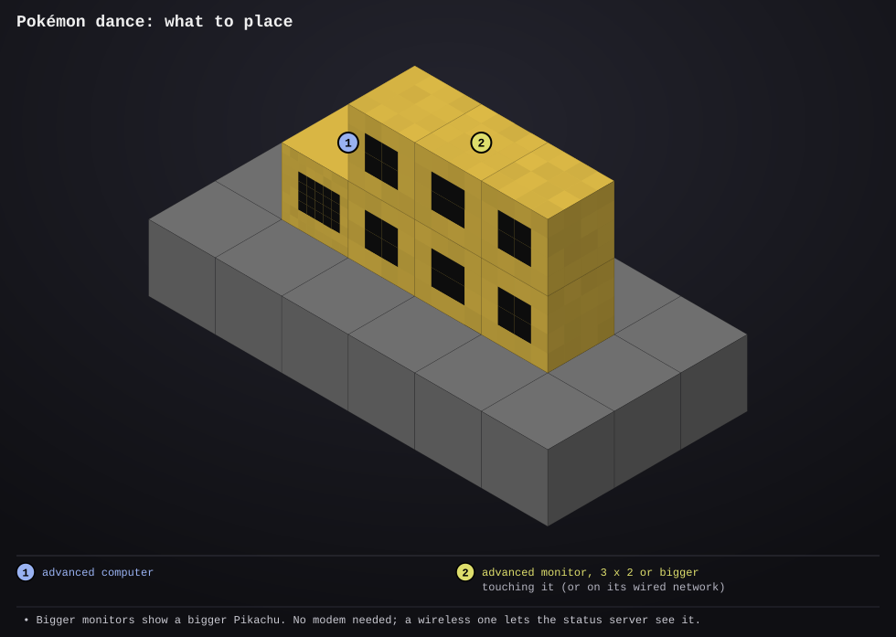

# pokemon-dance

- **Type:** advanced computer with an advanced monitor (without one it dances on the computer's own screen)
- **Computer ID:** 
- **Label:** 
- **Location:** 
- **Peripherals:** advanced monitor, touching the computer or on its wired network

## What it does

Pikachu dances on a monitor, forever. It bounces, sways its head from side
to side, waves one arm up and then the other, stamps its feet and wags its
lightning-bolt tail, under a spotlight on a flashing disco floor, with
sparkles twinkling and music notes floating up around it.

The dance is an eight-frame loop where the last frame leads straight back
into the first, so it never jumps or restarts. The bigger the monitor, the
bigger Pikachu gets: it grows in whole steps to the largest size that fits
(a 3 x 2 monitor shows it at its smallest, a 6 x 4 at twice that). It does
nothing else: no modem, no items, no settings to fill in.

## Files

- `dance.lua`: the program. The speed and colours are at the top.
- `startup.lua`: runs on boot: fetches any newer version from the website, then starts the dance and restarts it if it ever stops
- [`lib/screen.lua`](../../lib/screen.lua): draws each frame without flashing and finds the monitor (copy to `/lib/screen.lua`)
- [`lib/report.lua`](../../lib/report.lua): optional; tells the [status server](../status-server/README.md) it's dancing, if there's a wireless modem (copy to `/lib/report.lua`)
- [`lib/errlog.lua`](../../lib/errlog.lua): saves any error to `/errors.log` (copy to `/lib/errlog.lua`)
- `preview/setup.svg`: where to put the computer and monitor

## Setup



1. Place an advanced computer.
2. Put an advanced monitor, 3 x 2 or bigger, against any side of it. A
   monitor further away works too: put a wired modem on the computer and on
   the monitor, join them with cable and right-click both modems.
3. Install it and reboot. Pikachu starts dancing straight away.

```
dance                   -- start dancing (startup.lua runs it on boot)
dance monitor           -- list the monitors it can see and pick one
dance monitor none      -- dance on the computer's own screen instead
```

## Things to know

- With several monitors around, it takes one touching the computer first,
  else the first on the cable; `dance monitor` picks another.
- To make it dance faster or slower, change `FRAME_TIME` at the top of
  `dance.lua` (seconds per frame).
- Hold Ctrl+T on the computer to stop it; reboot to start again.
