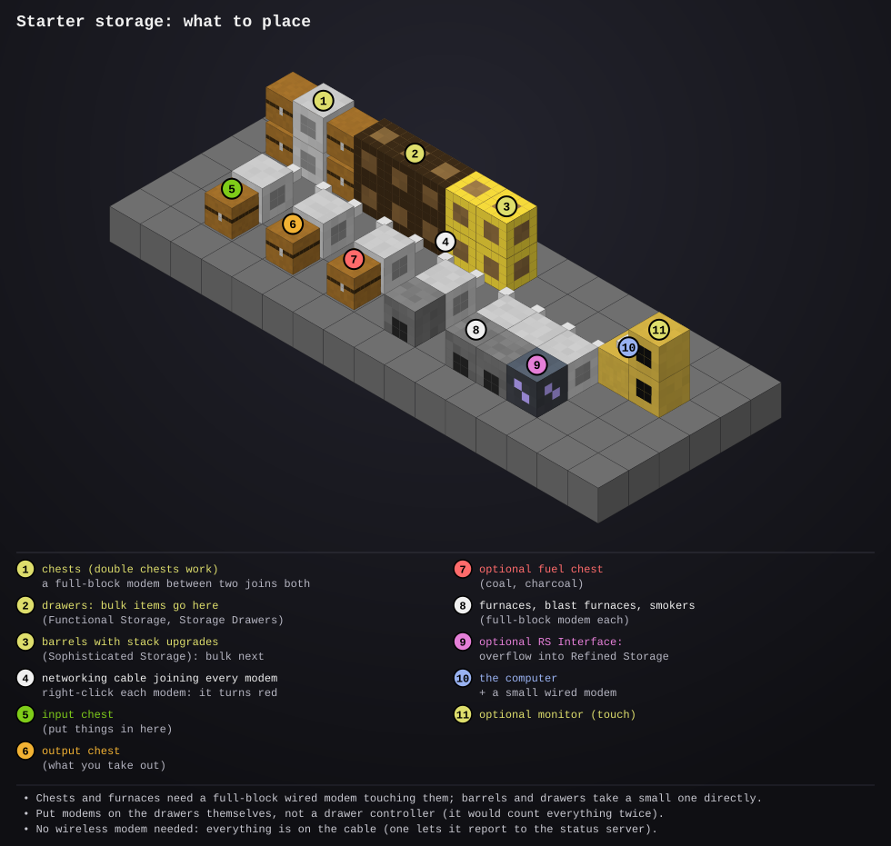

# starter-storage

- **Type:** computer (advanced for a touch monitor), plus wired modems and networking cable
- **Computer ID:** 
- **Label:** 
- **Location:** 
- **Peripherals:** a wired modem joined to every chest and furnace; optional monitor

## What it does

A whole storage room on one computer, for the first days of a world. Every
chest, barrel, drawer (Functional Storage, Storage Drawers) and
Sophisticated Storage chest or barrel on the cable becomes one store. Drop
things in the input chest and they're put away; search on the computer, or
tap the monitor, and they're sent to the output chest. Every furnace, blast
furnace and smoker on the same cable is kept busy too.

It puts things where they take the least room:

- An item that already has a drawer goes into that drawer, then onto its own
  part stacks.
- Things you have a lot of (256 or more) go into an empty drawer, else the
  storage with the most stack upgrades. Every 15 seconds a few stacks of
  them are moved out of plain chests, so the plain chests keep their slots
  for everything else.
- Small amounts go into plain chests first (the fullest one first), so
  drawers and upgraded storage stay free for bulk.
- When everything is full, the rest goes into Refined Storage (see
  [Refined Storage](#refined-storage)). If that's full too, it stays in the
  input chest and the screen says so.

Smelting works like the [factory's](../factory/README.md) smelter:

- Raw iron, gold and copper, other raw metals and ores (and Mekanism dust)
  are smelted by themselves, in blast furnaces first. Raw meat, fish and
  potatoes go into the smokers (16 potatoes are always kept to plant).
- When there's fuel for fewer than 32 coal's worth, logs are burnt into
  charcoal by themselves (32 of each kind of log are always kept).
- Everything else is smelted when you ask, from the Furnaces page: stone,
  smooth stone, glass, deepslate, bricks, terracotta, nether bricks, cracked
  stone bricks, smooth sandstone, smooth quartz, green dye, sponge and
  dried kelp. Or pick any item on the list and press F1.
- Fuel is coal, charcoal and coal blocks, put in to match what's in each
  furnace. They come from the fuel chest if you have one, else from storage.
  Coal and charcoal that come in go to the fuel chest first.
- What's smelted goes straight back into storage. Anything a furnace won't
  smelt is taken back out after 2 minutes.

It doesn't use rednet, turtles or other computers. When the base grows, the
[storage computer](../storage-computer/README.md) and the
[factory](../factory/README.md) can take over the same chests and furnaces.

## Files

- `stash.lua`: the program: setup, the screens and the work loop. Tunables are at the top.
- `stores.lua`: the chests, drawers and Refined Storage chests: where each item goes and where it's taken from.
- `furnaces.lua`: the furnaces: what's smelted by itself, the recipes you can order, and the fuel.
- `config.lua`: your settings (when bulk starts, charcoal, cooking, items to keep, extra recipes). Updates never overwrite it.
- `startup.lua`: runs on boot: fetches any newer version from the website, then keeps the stash running once it's set up.
- [`lib/screen.lua`](../../lib/screen.lua), [`lib/setupui.lua`](../../lib/setupui.lua): the screens and the setup screen.
- [`lib/files.lua`](../../lib/files.lua): crash-safe save files. [`lib/label.lua`](../../lib/label.lua): names the computer `Stash-<id>`.
- [`lib/report.lua`](../../lib/report.lua), [`lib/errlog.lua`](../../lib/errlog.lua): status for the [status server](../status-server/README.md) (needs a wireless modem; works without), and errors saved to `/errors.log`.
- `preview/`: the setup diagram.

## Setup



1. Put your chests, barrels, drawers and furnaces where you like, each with a
   wired modem touching it (a full-block wired modem for chests and
   furnaces, which a small modem can't go on; barrels and drawers take a
   small one), and join every modem to a wired modem on the computer with
   networking cable. Right-click each modem so it turns red.
2. Pick two chests for in and out, also on the cable: the **input chest**
   (what you drop in is put away) and the **output chest** (what you take
   comes here). Optionally a **fuel chest** for coal and charcoal.
3. Optionally put an advanced monitor on the cable (or touching the
   computer) to take things with a tap.
4. Reboot (or run `stash`): the setup screen opens on the computer and the
   monitor. Pick the input and output chests (and the fuel chest, RS chests,
   chests to leave alone) from lists that show what's in each, then Save. The
   stash starts, and from now on it starts by itself on every boot.

```
stash                    -- start (the setup screen the first time)
stash setup              -- change the chests (opens in the running stash too; or F5, or Setup on the monitor)
stash monitor            -- pick the monitor; 'stash monitor none' for none
```

On the computer:

```
type                     -- search (Backspace, Delete clears it)
Up / Down / PgUp / PgDn  -- pick an item (or click it; click it again to take)
Enter                    -- take the amount shown (64, 16, 1 or All; Tab changes it)
F1                       -- smelt that many of the picked item
F2                       -- send that many to Refined Storage
F3                       -- the Furnaces page: each furnace, the orders, what you can order
F4                       -- put back everything in the output chest
F5                       -- the setup screen
```

On the Furnaces page, Enter orders the picked recipe (the amount shown, or
All) and Delete stops the picked order. On the monitor: Furnaces / Items
switches page, the amount buttons pick how many, tap an item to take it,
Smelt and Stop work the orders, Put back empties the output chest.

## Refined Storage

No Advanced Peripherals needed: the stash uses Refined Storage's own blocks
as chests, picked in setup.

- **RS input**: an RS Interface on the cable (anything put in it goes into
  the RS network), or a chest an RS Importer empties. When the stash is full
  it overflows into this, and F2 sends the picked item there on purpose
  (good for many kinds of odds and ends: RS doesn't need a slot per kind).
  The stash can't see what's in Refined Storage after that: take it out with
  an RS Grid.
- **RS output**: an RS Interface's export slots (set in its screen), or a
  chest an RS Exporter fills. What's in it shows on the list with an `R`,
  and is taken last, after the stash's own chests.

To let your RS Grid see the stash's chests too, put an RS External Storage
on one of its drawers or chests: the stash reads every chest again each
minute, so it notices what RS took or added.

## Things to know

- The list marks items in drawers with `D`, in the RS output with `R` and
  in the fuel chest with `F`.
- Drawer controllers, compacting drawers and Sophisticated Storage
  controllers aren't used: they show items that are already in other
  drawers, so everything would count twice. Put modems on the drawers
  themselves.
- Ender chests, hoppers and machines on the cable are left alone. To keep a
  chest for yourself, add it under Not storage in setup.
- It reads every chest again each minute, so things you put in or take out
  by hand show up.
- Everything happens on this one computer, so very big networks are slow:
  when that happens, move to the [storage computer](../storage-computer/README.md)
  and [factory](../factory/README.md).
- `config.lua`: `bulk` (256: when an item counts as bulk), `charcoal` (32;
  0 = charcoal only on request), `cook` (false: no cooking by itself),
  `keep` (items never smelted by themselves), `recipes` (your own, e.g.
  Create's raw zinc).
