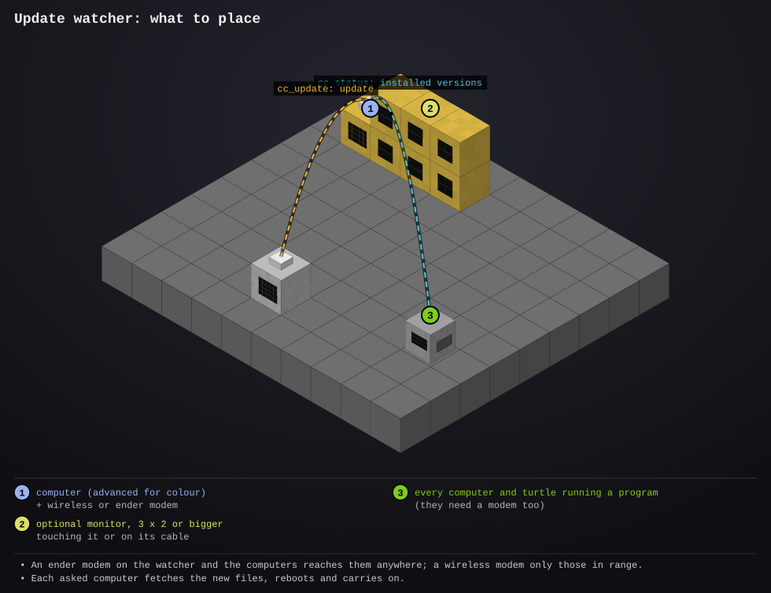

# update-watcher

- **Type:** computer (advanced for colour), plus a wireless or ender modem; a monitor is optional
- **Computer ID:** 
- **Label:** 
- **Location:** 
- **Peripherals:** wireless or ender modem, optional monitor (touching it or on its cable)

## What it does

Keeps every computer and turtle in range up to date with the website, so
after a new version is published you don't have to reboot each one by hand.

Every 2 minutes it looks at the website's program list. Every computer
running one of these programs already sends its status every 10 seconds
(for the [status server](../status-server/README.md)), and that report now
says which version of each program it has installed. When one is behind,
the watcher asks it to update: the computer fetches the new files in the
background (the same as it does on boot) and reboots, then carries on with
what it was doing (turtle jobs resume, services start again). If nothing
newer was there yet it just carries on without rebooting.

It asks one computer at a time, 5 seconds apart, so the base never goes down
all at once. A computer that's still behind is asked again after 3 minutes,
up to 5 times per new version (the website can take up to 10 minutes to hand
out a new version everywhere). Once everyone else is done it updates itself.

The screen (and the monitor, if there is one) lists every computer heard,
ones that need you first:

- **up to date** (green)
- **needs factory, lib...** (orange): out of date, will be asked soon
- **asking / asked to update / updating** (yellow)
- **no answer / says no / gave up** (red): see [Things to know](#things-to-know)
- **out of range / doesn't send versions** (grey)

With an ender modem, "in range" is every computer with an ender modem
anywhere; with a wireless modem it's the modem's range.

## Files

- `updates.lua`: the program. Tunables are at the top.
- `startup.lua`: keeps the watcher running (first it fetches any newer version from the website)
- [`lib/report.lua`](../../lib/report.lua): sends its status and answers update requests; on every other computer, it's what sends the versions and does the updating (copy to `/lib/report.lua`)
- [`lib/screen.lua`](../../lib/screen.lua): draws the screen and monitor without flashing (copy to `/lib/screen.lua`)
- [`lib/net.lua`](../../lib/net.lua): rednet requests with deadlines (copy to `/lib/net.lua`)
- [`lib/errlog.lua`](../../lib/errlog.lua): saves any error to `/errors.log` (copy to `/lib/errlog.lua`)
- `preview/setup.svg`: where everything goes

## Setup



1. Place a computer and put a wireless modem on it (an ender modem reaches
   every computer, however far away).
2. Optional: put a monitor next to it, or anywhere on its cable.
3. Install it and reboot:

```
wget run <site>/install.lua update-watcher   -- install it
reboot                                        -- start watching
updates auto off           -- only show what's out of date; press U to update them
updates auto on            -- update them by itself again (the default)
updates every 5            -- check the website every 5 minutes (default 2)
updates monitor            -- pick the monitor it shows the list on
updates monitor none       -- no monitor
```

While it runs: **U** (or tap **Update all**) asks every out-of-date computer
now, including ones it gave up on; **C** (**Check now**) looks at the website
straight away; **A** (**Auto**) turns updating by itself on or off.

On a computer you don't want it to touch:

```
set install.remote false   -- say no to the update watcher (still updates on boot)
set install.autoupdate false  -- no updates at all, on boot or from the watcher
```

## Things to know

- A computer has to be running one of these programs to be updated: it's
  the program's status reporting that listens. A turtle that finished its
  job and sits at the prompt, the status server, the turtle finder and
  instabuild don't listen; they update on their next boot.
- Computers installed before this program came out don't send their
  versions yet ("doesn't send versions"). Reboot each once and they will.
- **no answer**: the computer is heard but nothing answered, usually a
  program that doesn't listen (above), or it's busy and out of range of
  the watcher's modem one way.
- **says no**: `install.remote` or `install.autoupdate` is off there, or it
  has no installer (a program copied in by hand).
- A computer reboots in the middle of what it's doing. Every program here
  picks up again after a reboot (as after a chunk reload), but if you'd
  rather choose the moment, use `updates auto off` and press U.
